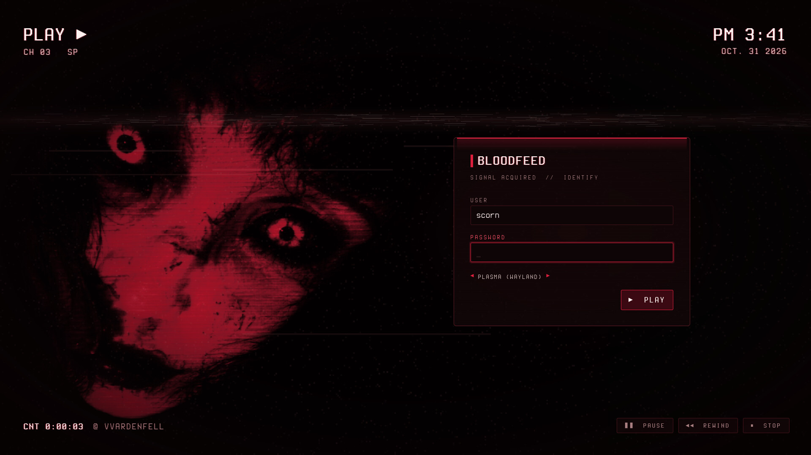
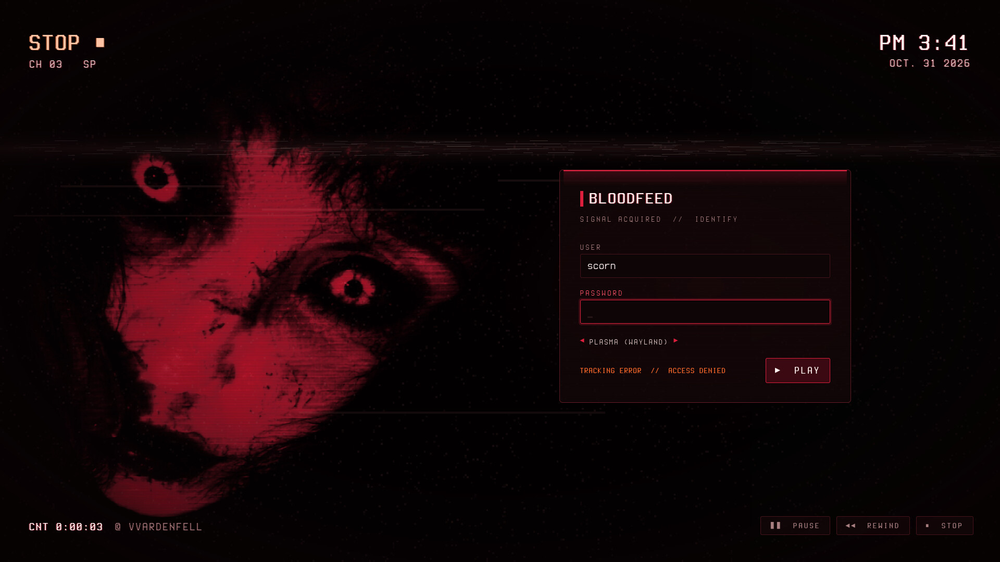

# Bloodfeed — SDDM Login

A blood-dubbed VHS login for SDDM (Qt6): VCR on-screen display, rolling tracking band, tape grain and tears, crimson-glow glass panel.



Bloodfeed is a blood-dubbed VHS look for KDE Plasma 6, built around a crimson-lit face on near-black: blood-black surfaces, faint scanlines and tape grain, and a slight crimson glow on whatever has focus.

## Features

- The wallpaper face as a tape on playback: scanlines, flickering grain, a soft tracking band rolling down the screen and a slow drift, like a tape that never quite settles.
- Every 7–16 s a tape tear: a slice of the picture jumps sideways and the frame jitters (set `glitches=false` in `theme.conf` to stop it).
- VCR on-screen display: blinking `PLAY ▶` top left, `AM 11:24` and the date top right, a running tape counter and the host name bottom left.
- Blood-black glass login panel with a crimson glow seam. The password shows as a strip of tape blocks.
- A wrong password flips the OSD to `STOP ■` with a scarlet `TRACKING ERROR // ACCESS DENIED` and a shake. Logging in fast-forwards (`FF ▶▶`) and the screen collapses to a line like a CRT switching off.
- Power controls are transport buttons: `❚❚ PAUSE` (suspend), `◀◀ REWIND` (reboot), `■ STOP` (shut down).
- Pure QtQuick, no shaders: every effect is an image swap or a transform, so it is light on integrated GPUs.



## Requirements

SDDM with the Qt6 greeter (`sddm-greeter-qt6`). The OSD font is bundled.

## Install

```bash
git clone https://github.com/numbpill3d/bloodfeed-sddm
cd bloodfeed-sddm && sudo ./install.sh
```

Or from the KDE Store: Extract to `/usr/share/sddm/themes/` and pick **Bloodfeed** in System Settings → Colors & Themes → Login Screen (SDDM).

## Configuration

`theme.conf`:

| key | default | |
|---|---|---|
| `background` | `assets/background.png` | any image; the face is kept to the left |
| `tagline` | `SIGNAL ACQUIRED // IDENTIFY` | line under the panel title |
| `channel` | `CH 03` | OSD channel label |
| `glitches` | `true` | `false` stops the tape tears |

## The rest of the suite

| piece | repo |
|---|---|
| Plymouth boot splash | [bloodfeed-plymouth](https://github.com/numbpill3d/bloodfeed-plymouth) |
| Global theme + splash screen | [bloodfeed-global](https://github.com/numbpill3d/bloodfeed-global) |
| Plasma style (panel, popups) | [bloodfeed-plasma](https://github.com/numbpill3d/bloodfeed-plasma) |
| Aurorae window decoration | [bloodfeed-aurorae](https://github.com/numbpill3d/bloodfeed-aurorae) |
| Colour scheme | [bloodfeed-colors](https://github.com/numbpill3d/bloodfeed-colors) |
| Kvantum widget style | [bloodfeed-kvantum](https://github.com/numbpill3d/bloodfeed-kvantum) |
| Icon theme | [bloodfeed-icons](https://github.com/numbpill3d/bloodfeed-icons) |
| Konsole + kitty colours | [bloodfeed-konsole](https://github.com/numbpill3d/bloodfeed-konsole) |

Everything at once, with the generators: [bloodfeed](https://github.com/numbpill3d/bloodfeed).

## Tags

`bloodfeed` `kde` `plasma6` `dark` `vhs` `scanlines` `crimson` `red` `blood` `horror` `retro` `analog-horror` `glow` `sddm` `sddm-theme` `login-screen` `qt6` `qml` `vcr` `osd`

## Credits and licence

By splicer scorn (voidrane). GPL-3.0-or-later.
OSD font: Terminess Nerd Font (Terminus, SIL OFL 1.1), bundled with its licence.
